# 🐾 Awesome Desktop Pet & Interactive Virtual Companions 🌟

  
  
  
  
  

  <strong>A curated ecosystem directory of SaaS virtual companions, desktop pets, Tamagotchi emulators, Live2D/VRM 3D desktop overlays, and local-first open-source AI screen buddies.</strong>

  <a href="#-sector-overview--market-dynamics">Sector Overview</a> •
  <a href="#-saashosted-platforms">SaaS &amp; Hosted Platforms</a> •
  <a href="#-open-source-github-projects">Open-Source Projects</a> •
  <a href="#-frameworks--toolkits-for-building-desktop-pets">Developer Frameworks</a> •
  <a href="#-how-to-contribute">Contributing</a> •
  <a href="#-support--sponsorship">Support</a> •
  <a href="#-star-history">Star History</a>

---

## 📌 Introduction & Scope

Welcome to the definitive, SEO-optimized directory of **Desktop Pets & Interactive Virtual Companions** 🐕🤖! Whether you are seeking a nostalgic retro screen-walker (like *eSheep*, *Shimeji*, or *oneko*), a cute pixel pet inside VS Code, an AI coding agent companion reacting to Claude Code and Cursor, or a full-fledged Live2D / 3D VRM digital avatar powered by local LLMs (Ollama, Whisper, Kokoro-TTS), this repository curates the top tools across Windows 🪟, macOS 🍎, Linux 🐧, and modern Web Browsers 🌐.

---

## 📊 Sector Overview & Market Dynamics

> **Market Size & Valuation:** The global interactive AI companion and digital virtual pet ecosystem is estimated at **$44 Billion – $49 Billion in 2026** (with adjacent consumer desktop robot pets contributing an additional ~$550 Million), and is projected to surpass **$350+ Billion by 2034** at an accelerating CAGR of ~32%.
> 
> **Market Dynamics & Fragmentation:** The sector exhibits **moderate fragmentation** at the application tier—characterized by massive consumer entertainment platforms capturing wide consumer mindshare, alongside high decentralization across specialized sub-niches (such as privacy-first local-hosted companions, retro desktop mascots, developer-focused coding agent companions, and open VTuber runtimes) where community-driven, user-owned open-source engines consistently outpace closed ecosystems.

---

## ☁️ SaaS/Hosted Platforms

The table below catalogs leading commercial and hosted virtual pet, companion, and digital character platforms. Entries are sorted descending by **Company Scale (Market Cap / Valuation / ARR)**:

| Platform / Product 🚀 | Company Scale (Valuation / Revenue) 🏢 | Starting Pricing Tier 💳 | Free Tier Limits / Trial Period ⏱️ | Core Features & Description 📝 |
| :--- | :--- | :--- | :--- | :--- |
| **[Tamagotchi Digital (Bandai Namco)](https://tamagotchi-official.com)** | ~$22 Billion Market Cap (TYO: 7832; ~$8.6B net sales) | $6.99/month (via Apple Arcade / App Store) | 30-Day Free Trial (Full game features included, no microtransactions or ads during trial) | Official cloud-synced digital Tamagotchi care ecosystem, adventure mini-games, and companion world. |
| **[Character.ai](https://character.ai)** | ~$2.7 Billion (Valuation based on Google licensing; ~$32M-$50M ARR) | $9.99/month (c.ai+ plan; or $4.99/month for c.ai+ Lite) | Free Forever: Unlimited standard chat messages; subject to traffic queues, basic memory, and standard speed caps. | Massive conversational cloud character catalog, group chat rooms, text-to-speech voice calls, and customizable personas. |
| **[Chai AI](https://chai-research.com)** | ~$2.4 Billion Valuation (Series A/B backed; ~$100M+ ARR run-rate) | $13.99/month (or $9.99/week Premium; $29.99/month Ultra) | Free Forever: ~70 messages per rolling refresh window, standard LLM access, and daily reward bonus pieces. | Mobile and web conversational roleplay engine powered by reinforcement learning and interactive character cards. |
| **[Replika (Luka, Inc.)](https://replika.com)** | ~$100M+ Valuation (~$14M ARR; $11M VC funding) | $19.99/month (or $69.99/year billed annually) | Free Forever: Unlimited text messaging strictly in 'Friend' relationship status; 3D room avatar customization. Voice calls & romantic modes locked. | Flagship personal companion avatar with 3D room customization, voice calls, diary entries, and empathetic memory. |
| **[Kindroid](https://kindroid.ai)** | Bootstrapped / Private (~$10M-$25M est. ARR) | $13.99/month (Standard plan; $139.99/year) | 3-Day Free Trial; new accounts receive a 50-message preview on the flagship model before switching to read-only mode. | Complex memory journals, persistent emotional context, photorealistic visual selfies, and low-latency voice calling. |
| **[Botify AI](https://botify.ai)** | Private / Indie SaaS (~$5M-$10M est. ARR) | $29.99/year (~$2.50/month billed annually for Premium) | Free Forever: Unlimited character browsing and standard text messaging with cooldowns and ad-supported banners. | Multi-character conversational directory, custom avatar builder, text-to-speech voices, and dynamic roleplay. |
| **[Anima AI (My Virtual AI Friend)](https://myanima.ai)** | Private / Indie SaaS (~$2M-$5M est. ARR) | $9.99/month (or $39.99/year billed annually) | Free Forever: Basic friend chat with core personality setup; advanced memory, romantic status, and voice calls locked. | Conversational companion offering daily check-ins, emotional support prompts, mini-games, and customizable sprites. |
| **[Desktop Mate / Steam Pet Suites](https://steampowered.com)** | Independent Commercial Studios (~$1M-$3M Gross) | Free to Play ($0 base; Character DLCs from $14.99 each) | Free Forever: Full baseline software with starter character (*Aieru-tan*), physics window climbing, and mini-games. | Steam-powered transparent desktop overlay characters with official workshop integration and physics interactions. |
| **[Shimeji Cloud Extension](https://shimejis.xyz)** | Community-Supported Web Portal (<$500k ARR) | Free ($0 / 100% Free Service) | Free Forever: Full access to online character directory, web mascot animations, and online Shimeji sprite editor. | In-browser animated desktop pets and screen-walking sprites compatible with Chromium and Firefox browsers. |
| **[Koko AI Desktop Companion](https://heykoko.app)** | Early-Stage Startup (<$500k ARR) | Free Plan (with paid family booster tiers from $4.99/mo) | Free Forever: 5 interactive voice/text answers per day, curated trivia facts, and basic daily learning check-ins. | Interactive voice-first companion pet designed for playful screen interactions, questions, and daily desk companionship. |

---

## 💻 Open-Source GitHub Projects

Explore the most active open-source desktop pets, screen toys, Tamagotchi simulators, and AI companions. Every project features a live GitHub star badge linking directly to its stargazer community and is sorted descending by **GitHub Stars**:

| Project & Repository 🌟 | GitHub Stars ⭐ | Primary Tech Stack 🛠️ | Key Capabilities & Highlights 🔍 |
| :--- | :---: | :--- | :--- |
| **[AIRI (`moeru-ai/airi`)](https://github.com/moeru-ai/airi)** |  | TypeScript, Vue, WebSockets | Comprehensive self-hosted virtual companion container supporting Live2D and 3D VRM models, voice duplex pipelines, gaming hooks, and chat. |
| **[SillyTavern (`SillyTavern/SillyTavern`)](https://github.com/SillyTavern/SillyTavern)** |  | JavaScript, Node.js | Industry-standard local-first frontend for LLM characters, supporting Character Cards, Live2D animated sprites, TTS/STT, and deep lorebook memory. |
| **[BongoCat (`ayangweb/BongoCat`)](https://github.com/ayangweb/BongoCat)** |  | Electron, JavaScript, C++ | Cross-platform interactive desktop mascot that mimics keyboard keystrokes, mouse clicks, and custom sprite reactions on your screen. |
| **[cc-haha AI Desktop Agent Pet (`NanmiCoder/cc-haha`)](https://github.com/NanmiCoder/cc-haha)** |  | Rust, Tauri, Vue, Python | Local-first Claude Code & AI agent desktop pet workspace: task-aware pets that watch code execution, diffs, git worktrees, and computer use. |
| **[Open-LLM-VTuber (`Open-LLM-VTuber/Open-LLM-VTuber`)](https://github.com/Open-LLM-VTuber/Open-LLM-VTuber)** |  | Python, Live2D, PyTorch | Voice-and-vision desktop companion featuring transparent overlay mode, Live2D lip-syncing, screen capture awareness, and offline Ollama/Whisper. |
| **[VPet Simulator (`LorisYounger/VPet`)](https://github.com/LorisYounger/VPet)** |  | C#, WPF, .NET | Widely popular open-source virtual pet simulator with high-resolution animation, feeding, work/study routines, custom mods, and Steam Workshop sync. |
| **[Clawd on Desk (`rullerzhou-afk/clawd-on-desk`)](https://github.com/rullerzhou-afk/clawd-on-desk)** |  | Rust, Tauri, Webview | A pixel-art desktop pet that monitors Claude Code, Codex, and Cursor CLI sessions in real-time, animating progress states while you build. |
| **[vscode-pets (`tonybaloney/vscode-pets`)](https://github.com/tonybaloney/vscode-pets)** |  | TypeScript, VS Code API | Beloved editor extension placing interactive cats, dogs, ducks, crabs, Clippy, and rubber ducks directly into your VS Code sidebar or explorer window. |
| **[Bongo Cat Web (`Externalizable/bongo.cat`)](https://github.com/Externalizable/bongo.cat)** |  | JavaScript, Canvas, CSS | The iconic web-based and desktop-embeddable bongo-tapping cat responding dynamically to piano notes, drum triggers, and typing strokes. |
| **[LingChat Galgame Pet (`SlimeBoyOwO/LingChat`)](https://github.com/SlimeBoyOwO/LingChat)** |  | Python, PyQt, LLM | Immersive AI-driven Galgame desktop pet with live emotional expressions, scheduling, interactive chat, and dynamic story dialogue. |
| **[three-vrm (`pixiv/three-vrm`)](https://github.com/pixiv/three-vrm)** |  | TypeScript, Three.js, WebGL | Official Pixiv library for loading, displaying, and animating 3D VRM avatars with spring-bone physics and facial expression blendshapes. |
| **[Amica (`semperai/amica`)](https://github.com/semperai/amica)** |  | TypeScript, Next.js, Three.js | 3D VRM virtual companion web & desktop app featuring speech recognition, real-time lip synchronization, emotional states, and vision. |
| **[OpenPets SDK (`OpenPetsHQ/openpets`)](https://github.com/OpenPetsHQ/openpets)** |  | TypeScript, Node.js | Local-first desktop companion SDK platform featuring custom pet animations, extensible hooks, and coding-agent integrations. |
| **[oneko.js (`adryd325/oneko.js`)](https://github.com/adryd325/oneko.js)** |  | JavaScript | Lightweight zero-dependency web & desktop script recreating the classic 1990s X11 `oneko` kitten that chases mouse cursors across the screen. |
| **[Asciiquarium (`cmatsuoka/asciiquarium`)](https://github.com/cmatsuoka/asciiquarium)** |  | Perl, Curses, ASCII | Classic, cozy terminal aquarium bringing animated ASCII fish, sharks, ducks, and underwater life to your command-line window. |
| **[Ark-Pets (`isHarryh/Ark-Pets`)](https://github.com/isHarryh/Ark-Pets)** |  | Java, LibGDX, Spine | Arknights-themed desktop companion bringing chibi-style characters with physics, gravity, and touch interactions to Windows/macOS. |
| **[desktopPet / eSheep (`Adrianotiger/desktopPet`)](https://github.com/Adrianotiger/desktopPet)** |  | C#, .NET, Win32 | Faithful modern recreation of the legendary 1995 stray sheep (eSheep) desktop toy that walks on application windows and sleeps on taskbars. |
| **[HachimoDock (`ai-maker-lab/HachimoDock`)](https://github.com/ai-maker-lab/HachimoDock)** |  | Electron, TypeScript | An animated desktop companion that responds in real-time to Claude Code sessions—thinking, juggling, typing, and celebrating task completions. |
| **[ChatVRM (`pixiv/ChatVRM`)](https://github.com/pixiv/ChatVRM)** |  | TypeScript, Three.js | Lightweight web demo that lets users talk to 3D VRM avatars using speech synthesis, microphone recognition, and local/cloud LLMs. |
| **[Desktop-Cat (`1ilit/Desktop-Cat`)](https://github.com/1ilit/Desktop-Cat)** |  | Python, Tkinter | Cozy pixel-art desktop kitty written in lightweight Python that roams across your screen, catches naps, and reacts to mouse clicks. |
| **[tamalib (`jcrona/tamalib`)](https://github.com/jcrona/tamalib)** |  | C, WebAssembly | Accurate C emulation library for Tamagotchi hardware (Tamagotchi P1/P2) compiled to WebAssembly for browser and desktop simulators. |
| **[mochimochi-man/aquarium_espresso](https://github.com/mochimochi-man/aquarium_espresso)** |  | Python, Qt, OpenGL | Cozy open-source interactive desktop aquarium and virtual creature runtime designed for lightweight desktop presence and screen-side comfort. |

---

## 🛠️ Frameworks & Toolkits for Building Desktop Pets

Looking to architect your own desktop pet or AI companion runtime? These battle-tested developer tools provide transparent windows, audio pipelines, and local inference:

- 🦀 **[Tauri (`tauri-apps/tauri`)](https://github.com/tauri-apps/tauri)**: The premier lightweight runtime for building transparent, click-through desktop overlay windows in Rust with minimal memory footprint (~25MB RAM vs ~200MB in Electron).
- 🎮 **[Godot Engine (`godotengine/godot`)](https://github.com/godotengine/godot)**: Open-source 2D/3D game engine supporting borderless transparent desktop windows, sprite sheets, and physics nodes for desktop pets.
- 🗣️ **[Kokoro-TTS (`hexgrad/kokoro`)](https://github.com/hexgrad/kokoro)** & **[Whisper.cpp (`ggml-org/whisper.cpp`)](https://github.com)**: Ultra-fast offline speech synthesis and speech-to-text recognition for responsive voice-enabled virtual pets.
- 🧠 **[Ollama (`ollama/ollama`)](https://github.com/ollama/ollama)**: Run local open-source LLMs (Llama 3, Gemma, Mistral, Qwen) privately on your hardware to drive your pet's conversation and memory without cloud API costs.
- 📐 **[Live2D Cubism SDK & Pixi-Live2D-Display](https://github.com)**: Industry standard 2D parameter-driven mesh animation framework for responsive desktop anime companions.

---

## 🤝 How to Contribute

Contributions are warmly welcomed! Help keep this curated resource fresh and useful:

1. 🍴 **Fork the repository** to your personal GitHub account.
2. 🌿 **Create a descriptive feature branch** (`git checkout -b feature/add-new-pet`).
3. 📝 **Add your entry** to either the SaaS or Open-Source table:
   - For SaaS: Name, link, company scale, exact starting price, exact free tier limits, and concise description.
   - For Open-Source: Repository name, link, star badge (`style=social&color=white`), tech stack, and key capabilities.
4. ✅ **Ensure entries maintain alphabetical or sorted order** where appropriate.
5. 🚀 **Submit a Pull Request** with a brief summary of the project.

---

## 💖 Support & Sponsorship

If this curated directory helped you discover a fun desktop companion, build a custom screen pet, or power your AI avatar project, consider supporting ongoing maintenance:

- ⭐ **Star this repository** to improve visibility on GitHub!
- 🍴 **Fork and share** with colleagues, Discord communities, and social media.
- ☕ **Sponsor the Maintainer:** Support development and curated open-source research directly via the [GitHub Sponsors Dashboard](https://github.com/sponsors/ishandutta2007). Your sponsorship helps keep community projects independent, updated, and ad-free!

  

---

## 📈 Star History

---

## ⚖️ Disclaimer

- This directory is a **community-curated index** provided for educational, research, and hobbyist purposes.
- Running continuous 60fps animations or GPU-shaded 3D companion overlays on battery power can increase CPU/GPU usage; configure appropriate idle frame-rate caps.
- For AI-enabled companions with microphone or screen capture features, ensure audio and visual buffers are kept on-device whenever private data is on screen.

  Curated with ❤️ by <a href="https://github.com/ishandutta2007">Ishan Dutta</a> and the global open-source community.

